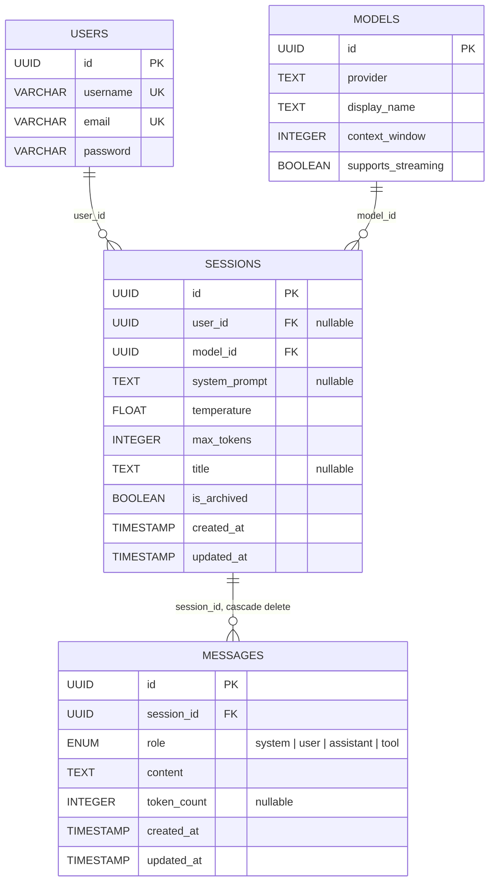

# Chat with model

Проект чат-клиента на React/Vite и API на FastAPI с PostgreSQL и SQLAlchemy.
Описание текущих API-ограничений и план для списка чатов находятся в
[Api.md](./Api.md).

## Схема базы данных

В приложении определены таблицы `users`, `models`, `sessions`, `messages`.
Таблица `generations` удалена.



ORM-связи доступны как `user.sessions` и `session.user`. `user_id` пока допускает
`NULL`; создание сессии ещё не связывает её с владельцем. Добавление колонки в
уже существующую таблицу требует миграции — `create_all()` не обновляет схему.

## Запуск фронтенда

```powershell
cd frontend
npm install
npm run dev
```

По умолчанию клиент обращается к API на `http://localhost:8000`. URL можно
переопределить переменной `VITE_API_URL`.

## Текущее состояние

Фронтенд содержит вход/регистрацию, настройки нового чата и интерфейс диалога.
Создание списка чатов, восстановление истории из списка, корректное владение
сессиями и некоторые контракты API ещё требуют реализации. Подробный перечень
и объявленные маршруты см. в [Api.md](./Api.md).
